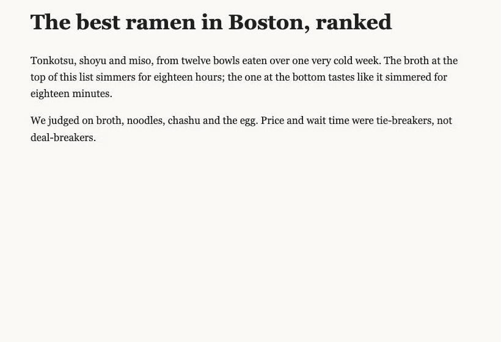
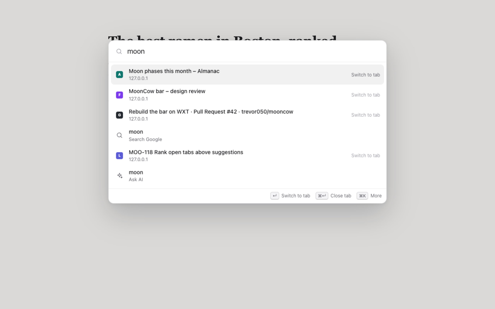
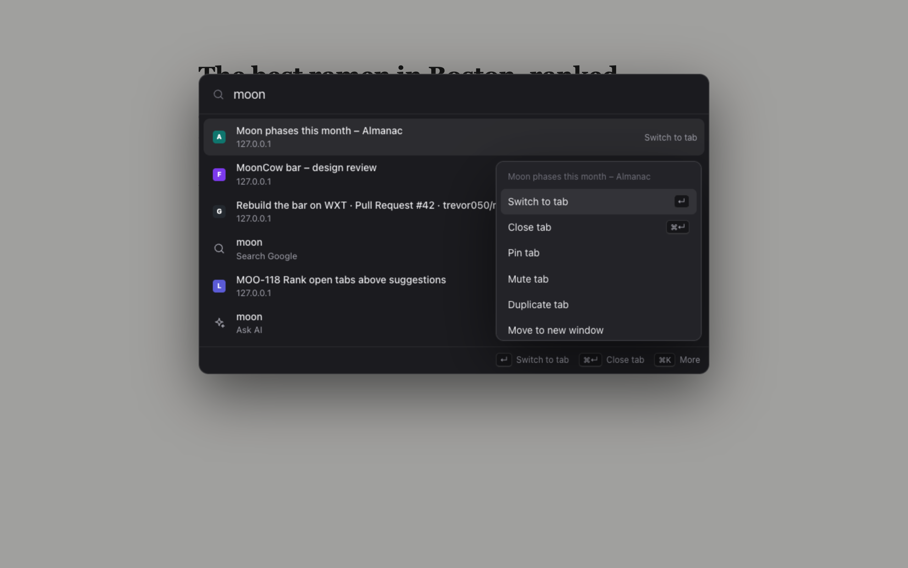
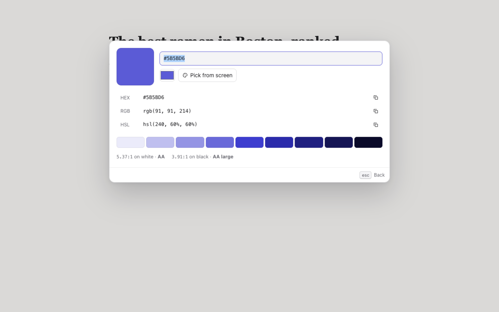
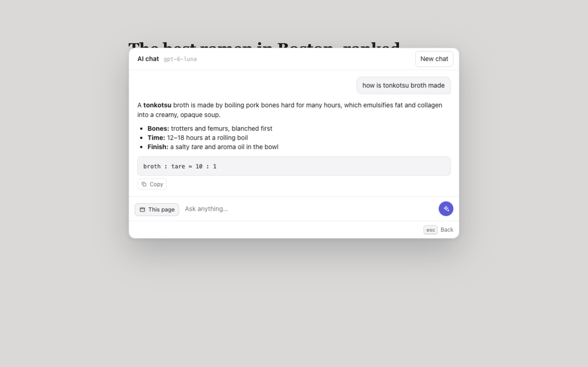

# MoonCow

A command bar for Firefox, Zen and Chrome that tries to be the main way you use your browser. One shortcut, then type: it finds your open tabs, the tab you just closed, the site you always go to, your bookmarks and history, runs tab commands, and answers the small stuff (math, units, colors, hashes, dates, definitions) right there, so you never open a tab to visit some ad-covered converter site again.



## The idea

What if everything was Spotlight? Arc got closest to this and Arc is going away. No browser goes far enough with the bar, so MoonCow is my attempt. It has two halves, and both matter:

- **Get to the thing.** Open tabs come first, across every window, fuzzy on title and address. Then recently closed tabs, the sites you actually use, past searches, bookmarks and history. Then the web. Every row has verbs: switch, close, pin, mute, move it to a new window, copy the URL. The goal is that you mostly stop using the tab strip and the address bar.
- **Answer it in place.** Why go to Google, or to some random junk site, for a color picker or a hash or "how many days until X"? If you need it often and you're fast on the keyboard, it should just be there. And it has to be *right*: a tool that misfires once teaches you to stop trusting the bar, so every tool only fires when it should and is tested on the inputs where it must stay quiet.

Everything in the bar, built-in or not, is a plugin on the same small API. More on that below.

| Open tabs and history first | Every row has verbs (⌘K) |
| --- | --- |
|  |  |

| Colors, with tints and contrast | AI on your own key |
| --- | --- |
|  |  |

## Install it (from source, for now)

It's not on the extension stores yet. You need Node 22.12 or newer.

```sh
git clone https://github.com/trevor050/mooncow.git
cd mooncow
npm install
npm run build        # builds .output/chrome-mv3 and .output/firefox-mv3
```

Every pull request also builds both packages in CI; grab `mooncow-chrome` or `mooncow-firefox` from the run's artifacts if you don't want to build.

**Firefox and Zen** (Firefox 140+; I daily drive Zen)
1. Go to `about:debugging#/runtime/this-firefox`.
2. Click **Load Temporary Add-on…** and pick `.output/firefox-mv3/manifest.json`.
3. Temporary add-ons go away when the browser restarts. For a permanent install you need a signed build (see the roadmap).

**Chrome and other Chromium browsers**
1. Go to `chrome://extensions` and turn on **Developer mode**.
2. Click **Load unpacked** and pick `.output/chrome-mv3`.

Then press **Ctrl+E** (**⌘E** on a Mac).

## Using it

| Keys | |
| --- | --- |
| ↑ ↓ (or Ctrl+N / Ctrl+P) | move |
| Enter | run the row's main action |
| ⌘/Ctrl+Enter | run its second action (shown in the footer) |
| ⌘/Ctrl+K | every action for the selected row |
| Tab | complete a suggestion into the bar |
| Esc | back out of a view, or close |

Start with `>` to see only commands, `@` to pick a site to search, `?` for everything MoonCow can do (that list is generated from the installed tools, with examples you can click).

### What's in the box

| | Try |
| --- | --- |
| **Open tabs**, every window, fuzzy | `gmail`, `pr review`, `gml` |
| **Recently closed** tabs, restored with their history | `closed`, `reopen hacker news` |
| **Frequent sites** (autofill), **past searches**, **bookmarks**, **history** | `gith`, `ramen` |
| **Tab and window commands** | `close duplicates`, `close other tabs`, `reopen closed tab`, `pin tab`, `mute tab`, `move tab to new window`, `copy url`, `screenshot` |
| **Site search** | `@yt lofi`, `@gh wxt`, `useEffect mdn`, `site react hooks` (the site you're on) |
| **Calculator** and **equation solver** | `2^10 / 3`, `15% of 80`, `tip 18% 64.20 for 3`, `5x + 3 = 8` |
| **Units** and **currency** (ECB rates) | `10 km to mi`, `72 f in c`, `3 cups to ml`, `25 usd to eur` |
| **Color** | `#ff8800`, `rgb(30 144 255)`, `color picker` |
| **Dates and time zones** | `days until christmas`, `90 days from today`, `3pm est in tokyo`, `time in lagos`, `unix 1700000000` |
| **Hashes and encoders** | `sha256 hello`, `md5 hello`, `base64 hi`, `urlencode a b`, `255 to hex`, `snake Hello World` |
| **Inspect** pasted JWTs and JSON | paste a token or `{"a":1}` |
| **Generators** (crypto-random) | `password 24`, `uuid`, `flip a coin`, `random 1-100`, `roll 2d6+3` |
| **Dictionary** and **spelling** | `define ephemeral`, `spell definately` |
| **Weather** | `weather tokyo` |
| **QR codes**, generated locally | `qr`, `qr https://example.com` |
| **AI chat**, optionally about the current page | `ai explain this error`, `summarize this page` |

## Where the bar shows up, and the honest limits

Browsers don't let an extension take over everything. Here's what MoonCow does and what it can't:

| Surface | What works | The catch |
| --- | --- | --- |
| **Shortcut** (Ctrl+E / ⌘E) | Opens the bar over any normal page. | Firefox and Chrome both let you change it (`about:addons` → gear → Manage Extension Shortcuts, or `chrome://extensions/shortcuts`). If the browser or another extension already owns the key, the browser wins. Some sites grab keys first; MoonCow also listens in the page as a fallback. |
| **Browser pages** (`about:`/`chrome://` pages, the extension stores, PDF viewers) | The assigned extension shortcut or toolbar button opens the bar in a small window instead. | Extensions can't put anything on top of these pages. |
| **New tab page** | Every new tab is the bar at full size. | Both browsers put the cursor in the address bar on a new tab and don't let a page take it, so click the bar or press Tab once. In Firefox and Zen you choose between MoonCow and the default in **Settings → Home → New tabs**. In Chrome, turning it off in MoonCow settings hands new tabs back to Chrome's page. |
| **Address bar** | Type `mc` and a space, then a calculation, conversion, date, hash or `@site` query to get answers in the dropdown. Enter opens addresses, site searches, or a web search. | Extensions can't replace the address bar or its suggestions, and can't claim Ctrl+L / Ctrl+T. |

On Windows, Zen reserves Ctrl+E for its own search. MoonCow's page fallback still opens the overlay, but it cannot run on browser pages. Assign an unused extension shortcut for those pages; Ctrl+Shift+Y was tested with the popup on Zen's Settings page.

Zen normally opens its floating URL bar for Ctrl+T. To use MoonCow as the full new-tab page, set `zen.urlbar.replace-newtab` to `false` in `about:config` and select MoonCow for new tabs. The `mc` keyword also works in Zen's floating address bar.

Zen shares tabs between windows in the same Space. Its extension API gives mirrors separate tab IDs, so MoonCow pauses **Close duplicate tabs**, **Close other tabs**, and **Close tabs to the right** while multiple Zen windows are open. Nothing is closed in that case. With one window, bulk closing preserves active and pinned tabs; duplicate cleanup only combines exact addresses, including their fragments and trailing path slashes.

## AI

AI is optional and runs on your own key. MoonCow talks to any **OpenAI-compatible Chat Completions** endpoint, streams the answer, and renders Markdown safely (it never injects HTML from the model).

- **OpenAI**: base URL `https://api.openai.com/v1`, model `gpt-6-luna` (the default; any model name works).
- **OpenRouter**: `https://openrouter.ai/api/v1`.
- **Local**: Ollama (`http://localhost:11434/v1`), LM Studio (`http://localhost:1234/v1`), llama.cpp, vLLM. Local servers usually don't need a key.

Set it up in **Settings** (type `settings`), or just try asking something and the bar walks you through it. The key lives in the browser's extension storage on your machine and is only ever sent, as a Bearer token, to the endpoint you entered. When you press **This page** in the chat, the page's visible text (and your selection) goes with the question.

## Privacy and permissions

Everything stays in your browser except:

- **AI questions** (and page text, when you include it) go to the AI endpoint you configured.
- **Lookups you type explicitly** go to keyless public APIs: definitions and spelling (Wiktionary, Datamuse), weather and city times (Open-Meteo), exchange rates (Frankfurter), `my ip` (ipify).
- **Search suggestions** go to Google only if you turn them on in settings. They're off by default because they send what you type as you type it. Your own past searches are suggested locally either way.

Tabs, history, bookmarks, what you pick (MoonCow learns your favorites locally), colors, hashes, dates, JSON and JWT decoding never leave the browser. Favicons come from the browser's own cache (Chrome) or your open tabs (Firefox), never from a favicon service.

| Permission | Why |
| --- | --- |
| `tabs` | Search, switch, close, pin, mute and move tabs. |
| `history` | Frequent sites, past searches and history results; "Remove from history". |
| `bookmarks` | Bookmark results and "Bookmark this page". |
| `sessions` | Recently closed tabs and "Reopen closed tab". |
| `storage` | Settings, the saved chat and what you pick, all local. |
| `scripting`, `activeTab` | Add the bar to tabs that were open before MoonCow was installed; screenshot the visible tab when you ask. Browsers only allow the screenshot right after you open MoonCow with its shortcut or toolbar button. |
| `clipboardWrite` | Copy answers. |
| `favicon` (Chrome only) | Show site icons from Chrome's local cache. |
| Content script on all pages | Draws the bar over the page and reads the page's text when you ask AI about it. |
| Optional host access | Requested for one origin at a time: your AI endpoint when you save it, and Google Suggest if you turn suggestions on. Nothing else. |

## Writing a tool

Every built-in (tabs, the calculator, AI, everything) is a plugin on the same API in [`src/core`](src/core). A tool answers three questions: does this query belong to me, how sure am I, and what does the row look like and do. Here's the dice roller, which ships as [`src/tools/dice.ts`](src/tools/dice.ts) mostly to show this off:

```ts
import { copyAction, defineTool, RELEVANCE } from '@/core';
import { secureInt } from '@/lib/random';

export default defineTool({
  id: 'dice',
  name: 'Dice',
  description: 'Roll dice in standard notation: d20, 2d6+3, roll 4d8.',
  examples: ['roll', 'd20', 'roll 2d6+3'],

  match(query) {
    // Precise matching: the whole query is dice notation, or it starts with "roll".
    // query.command() only matches a leading trigger, so "how to roll sushi" never gets here.
    const afterRoll = query.command('roll');
    const dice = parseDice(afterRoll === '' ? 'd6' : afterRoll ?? query.text);
    if (!dice) return null;

    const rolls = Array.from({ length: dice.count }, () => secureInt(1, dice.sides));
    const total = rolls.reduce((a, b) => a + b, 0) + dice.modifier;

    return {
      id: 'roll',
      kind: 'answer',                       // renders the answer big
      title: `Roll ${dice.count}d${dice.sides}`,
      answer: String(total),
      icon: { glyph: 'dice' },
      relevance: afterRoll !== null ? RELEVANCE.explicit : RELEVANCE.parsed,
      actions: [
        copyAction(String(total)),           // Enter
        { title: 'Roll again', run: (ctx) => ctx.refresh() }, // ⌘Enter
      ],
    };
  },
});
```

Then add it to [`src/tools/index.ts`](src/tools/index.ts). That's it. The rest of the API:

- **Matching**: `query.command(...)`, `query.is(...)`, `query.prefixOf(...)`, `query.suffix(...)` and anchored regexes. There's deliberately no "contains this word" helper.
- **Ranking**: pick a `RELEVANCE` band (`explicit`, `parsed`, `strong`, `fallback`, `partial`, `weak`) honestly. One ranker sorts every tool's rows by band, then by kind, plus a small boost learned from what you pick. The boost can reorder rows within a band but never lift a loose match over a precise one.
- **Async**: `match` can be `async` (results stream in), or return a row with a `hydrate()` step for network lookups (the converter fetches rates this way). Old answers can never overwrite a newer query.
- **Rendering**: rows are data (title, subtitle, answer, icon, accessory). For anything richer, an action calls `ctx.showView(view)` and you get the panel body to yourself; the chat, color picker, QR code and help list are views.
- **Actions** get a small context: `open`, `copy`, `toast`, `setQuery`, `refresh`, `showView`, `close`, and a `browser` bridge for tab work.

## Development

```sh
npm run dev            # Chrome with live reload (WXT)
npm run dev:firefox    # Firefox with live reload
npm test               # unit tests (Vitest)
npm run typecheck
npm run lint           # typecheck + Mozilla's add-on linter on the Firefox build
npx playwright install chromium # once, before the Chromium end-to-end suite
npm run test:e2e       # Playwright drives the built extension in Chromium
npm run test:firefox   # same idea in real Firefox (or Zen: FIREFOX_BIN=/path/to/zen)
npm run zip            # store-ready zips, plus the sources zip Firefox reviewers ask for
```

The Firefox smoke test finds a standard Firefox installation on macOS and Windows. To run it against Zen on Windows, use PowerShell:

```powershell
$env:FIREFOX_BIN = "$env:ProgramFiles\Zen Browser\zen.exe"
npm run test:firefox
```

For a shared Windows test host, set `MOONCOW_E2E_PROFILE` to one persistent profile directory. The Chromium suite then uses one browser process for the run and clears test state between cases. `MOONCOW_CHROMIUM_BIN` selects installed Chrome; `MOONCOW_FIREFOX_PROFILE` reuses a Firefox/Zen smoke-test profile. `MOONCOW_BROWSER_GATE` can point to a host-provided PowerShell launch guard.

The test suite covers the tool API, ranking, every tool's answers, and a table of look-alike queries where tools must stay silent ("back to the future" must not run *Go back*, "password manager reviews" must not generate a password). The end-to-end tests load the real extension and check the overlay, tab switching, the action menu, tab commands, the new tab page and AI streaming against a local mock server.

It's TypeScript on [WXT](https://wxt.dev), one source for both browsers. Layout: `src/core` (the tool API and ranking), `src/tools` (every built-in), `src/lib` (pure logic), `src/ui` (the bar), `src/entrypoints` (background, content script, the bar's page, new tab, settings).

## Roadmap

- Get it signed and listed on addons.mozilla.org and the Chrome Web Store.
- Load third-party tools without a rebuild.
- More verbs on more rows (send a tab to a window, tab groups in Chrome, Zen workspaces once Zen exposes them to extensions).
- Better ranking from what you pick, still local.

Bugs and ideas welcome. Open an issue with steps to reproduce; a short screen recording helps a ton.

## License

MIT. Use it, fork it, ship your own flavor.
